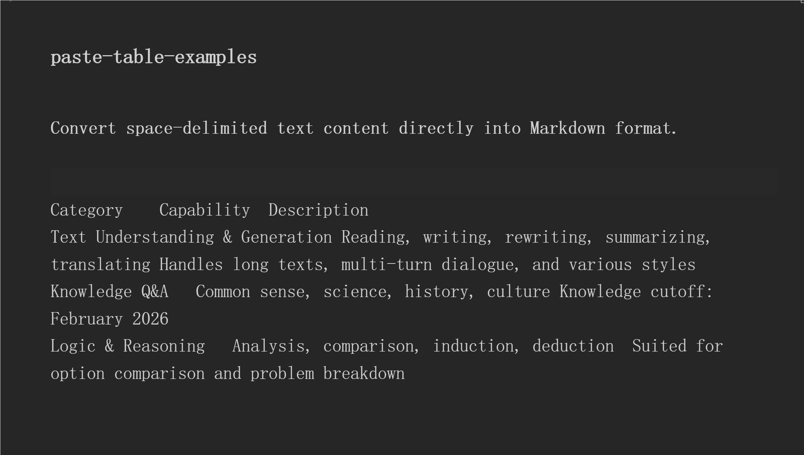

<div align="center">

# Paste Table

**Obsidian plugin · Any plain text with structure becomes a real Markdown table — copy it from anywhere, or just type it yourself, then one click.**

[](https://github.com/SpiderK-104/paste-table/releases/latest)
[](LICENSE)
[](https://github.com/SpiderK-104/paste-table)
[](https://github.com/SpiderK-104/paste-table/actions)
[](#中文文档)

</div>

## Preview



## The problem

Writing a Markdown table by hand means remembering the boilerplate:

```markdown
| Header | Header |
| --- | --- |
| Cell | Cell |
```

Every column needs a `|`, and you need a `| --- |` separator line. It's noisy, easy to break, and it forces you to decide the table syntax *before* you have the content.

## The idea

You already know your data — you just don't want to type table syntax. So write or copy the content naturally, keeping the columns visually separated by a `Tab`, several spaces, or a `|`, then let the plugin do the syntax.

**Where the text comes from doesn't matter:**

| Source | Example |
| --- | --- |
| AI chat (ChatGPT / Claude / DeepSeek / Doubao / Yuanbao …) | copy the answer |
| Web page, docs, issue tracker | copy the table block |
| Excel / Numbers / Google Sheets | copy a range |
| PDF viewer, terminal, log file | copy the aligned output |
| A note in another vault or app | copy a plain-text block |
| **Your own keyboard** | type the header, align the columns, fill in the cells |

That last one is the point: **you don't need anything to copy.** Type a header line, start the next line at the same visual columns, fill in the cells, select the block, and convert. No `|`, no `---`, no counting columns.

```text
Capability      Command              Use case
Cache object    SET / GET / EXPIRE   user profile, config, session
Batch caching   MSET / MGET          fewer network round-trips
```

→ one click →

| Capability | Command | Use case |
| --- | --- | --- |
| Cache object | SET / GET / EXPIRE | user profile, config, session |
| Batch caching | MSET / MGET | fewer network round-trips |

## Features

- **Clipboard → table**: read the clipboard, auto-detect the structure, insert a real Markdown table. No dialog, no interruption.
- **Selection → table**: select any aligned text already in your note and turn it into a table. Works for text you just typed yourself.
- **Four parsing strategies**, auto-detected in priority order:
  - `Tab`-separated (what most apps and AI chats put on the clipboard)
  - `|` pipe-separated (existing / hand-written Markdown tables — reformat them cleanly)
  - N consecutive spaces (visually aligned columns, including variable-width gaps)
  - single spaces with consistent column counts (short tables with no spaces inside cells)
- **Never breaks your text**: if the content doesn't look like a table, it is inserted as-is instead of being mangled.
- **Row number column** (optional): prepends `# / 1 / 2 / 3 …` to the leftmost column.
- **HTML fallback**: converts clipboard HTML `<table>` when the source provides one.
- **Ragged rows are padded**: rows with fewer cells than the header are filled in, so the Markdown stays valid.
- **Fully offline**: all conversion happens locally. No telemetry, no network requests, no note content ever leaves your vault.

## Installation

### Option 1: Obsidian Community plugins (recommended)

**Settings → Community plugins → Turn off Restricted mode → Browse → search "Paste Table" → Install & Enable**

If the official directory is hard to reach, [PKMer Market](https://pkmer.cn/products/plugin/pluginMarket/) mirrors the plugin for install and update.

### Option 2: Manual install

1. Download `main.js`, `manifest.json`, `styles.css` from the [releases](https://github.com/SpiderK-104/paste-table/releases)
2. Place them in your vault's plugin folder and restart Obsidian:

```
<Vault>/.obsidian/plugins/paste-table/
```

## Usage

> Tip: bind `Ctrl+Shift+V` to **Clipboard plain text** (Settings → Hotkeys) for an instant "copy → paste-as-table" workflow.

| Command | Description |
| --- | --- |
| **Clipboard plain text** | Read the clipboard and insert it as a Markdown table when a table structure is detected |
| **Convert selection: text to table** | Convert the selected `Tab` / space / pipe-aligned text into a Markdown table |
| **Clipboard HTML** | Convert clipboard HTML `<table>` data (fallback) |

### Workflow A — copy from anywhere

1. Copy the content in any app (AI chat, web page, spreadsheet, another note…).
2. Back in Obsidian, press `Ctrl+Shift+V` (or run **Clipboard plain text** from the palette).
3. The table is inserted. Done.

### Workflow B — type it yourself

1. Type the header line, e.g. `Capability<Tab>Command<Tab>Use case`, or separate columns with two or more spaces.
2. Press `Enter` and fill in the rows, keeping the columns roughly aligned (or keep using `Tab`).
3. Select the whole block.
4. Run **Convert selection: text to table**.
5. A valid Markdown table replaces the selection — no manual `|`, no `---`.

## Settings (Settings → Paste Table)

| Setting | Description | Default |
| --- | --- | --- |
| Row number column | Show `# / 1 / 2 / 3 …` on the leftmost column | Off |
| Min space gap | How many consecutive spaces count as a column separator | 2 |

## FAQ

**Q: My content was inserted as-is instead of being converted.**
A: It failed the "looks like a table" check — usually a single line, or not enough structure. Try separating columns with `Tab` instead of spaces, or lower **Min space gap**.

**Q: My hand-typed columns look wrong.**
A: Column detection is based on separators, not pixel positions. Use `Tab` between cells (most reliable), or keep at least two spaces between columns and don't put double spaces inside a cell.

**Q: I already have a Markdown table — what happens?**
A: Pipe-separated text is detected too, so existing tables are simply normalized (separator rows cleaned up, missing cells padded).

**Q: Do you upload my notes or clipboard?**
A: No. Everything runs locally; the plugin makes no network requests.

**Q: Does it work on mobile?**
A: It is a desktop-only plugin (`isDesktopOnly: true`) because it reads the system clipboard. Mobile support may be evaluated later.

**Q: Hotkey not working?**
A: Obsidian doesn't reserve `Ctrl+Shift+V` by default — bind the command under Settings → Hotkeys.

## Development

```bash
git clone https://github.com/SpiderK-104/paste-table.git
cd paste-table
npm install        # install dependencies
npm run dev        # watch mode
npm run build      # production build
npm run lint       # lint
```

## License

[MIT](LICENSE)

## Credits

- [Obsidian plugin developer docs](https://docs.obsidian.md)
- [obsidian-sample-plugin](https://github.com/obsidianmd/obsidian-sample-plugin)

---

## 中文文档

### 为什么会有这个插件？

手写一张 Markdown 表格，意味着你要记住那些烦人的语法：

```markdown
| 表头 | 表头 |
| --- | --- |
| 内容 | 内容 |
```

每一列都要敲 `|`，还得补一行 `| --- |`。又吵又容易敲错，而且你往往得先想好语法，才能开始填内容。

### 换个思路

**数据你本来就知道，你只是不想敲表格语法。**

所以像平时一样写、或直接复制内容，只要列与列之间用 `Tab`、连续空格或者 `|` 分开，剩下的交给插件。

**内容从哪来不重要：**

| 来源 | 例子 |
| --- | --- |
| AI 对话（豆包 / DeepSeek / 腾讯元宝 / ChatGPT / Claude …） | 复制回答里的表格 |
| 网页、文档站、Issue 列表 | 复制表格块 |
| Excel / Numbers / Google Sheets | 复制一段区域 |
| PDF 阅读器、终端、日志 | 复制对齐的输出 |
| 别的笔记或别的仓库 | 复制一段纯文本 |
| **你自己动手敲** | 先写表头，把列对齐，再填内容 |

最后一种才是重点：**你根本不需要任何"可复制的东西"。** 敲一行表头，换行后按同样的视觉位置填内容，选中这一块，转成表格。不用敲 `|`，不用敲 `---`，也不用数列数。

```text
能力          用到的指令            场景
缓存对象      SET / GET / EXPIRE   用户信息、配置、session
批量缓存      MSET / MGET          减少网络往返
```

→ 一键 →

| 能力 | 用到的指令 | 场景 |
| --- | --- | --- |
| 缓存对象 | SET / GET / EXPIRE | 用户信息、配置、session |
| 批量缓存 | MSET / MGET | 减少网络往返 |

### 功能特性

- **剪贴板转表格**：读取剪贴板 → 自动识别结构 → 直接插入 Markdown 表格，**无弹窗、无干扰**
- **选中转表格**：笔记里已有的任意对齐文本（哪怕是你刚敲的），选中后一键转正
- **四种解析策略**，按优先级自动识别：
  - `Tab` 分隔（多数应用和 AI 对话复制出来的就是这种）
  - `|` 管道分隔（已存在的 / 手写的 Markdown 表格，顺手帮你格式化）
  - 连续 n 个空格（视觉对齐的列，列宽不一致也能处理）
  - 单空格但各行列数高度一致（短表格，单元格内不含空格）
- **不破坏原文**：判断不像表格的内容会原样插入，不会被弄乱
- **数字排序列**（可选）：表格最左侧自动插入 `# / 1 / 2 / 3 …` 序号列
- **HTML 保底**：剪贴板里确实有 HTML `<table>` 时也能转换
- **自动补齐**：列数不足的行会补上空单元格，保证 Markdown 结构合法
- **离线运行**：纯本地逻辑，不上传任何数据，无任何网络请求

### 安装

**设置 → 第三方插件 → 关闭安全模式 → 社区插件 → 浏览 → 搜索 "Paste Table" → 安装并启用**

国内访问官方市场困难时，推荐使用 [PKMer Market](https://pkmer.cn/products/plugin/pluginMarket/) 加速安装与更新。

### 使用

> 建议把 `Ctrl+Shift+V` 绑定到 **Clipboard plain text**（**设置 → 快捷键**），实现「复制 → 粘贴即表格」。

| 命令 | 说明 |
| --- | --- |
| **Clipboard plain text** | 读取剪贴板，检测到表格结构即转成 Markdown 表格插入 |
| **Convert selection: text to table** | 将选中的 Tab / 空格 / 管道对齐文本转换为表格 |
| **Clipboard HTML** | 剪贴板有 HTML `<table>` 时按 HTML 转换（保底方案） |

**用法 A：从任何地方复制**

1. 在任意应用里复制内容（AI 对话、网页、表格软件、另一篇笔记……）
2. 回到 Obsidian，按 `Ctrl+Shift+V`（或从命令面板执行 **Clipboard plain text**）
3. 表格已插入，完成

**用法 B：自己敲**

1. 敲一行表头，例如 `能力<Tab>用到的指令<Tab>场景`，或者用两个以上空格分列
2. 回车后填内容，保持列大致对齐（或者干脆一直用 `Tab`）
3. 选中这一整块
4. 执行 **Convert selection: text to table**
5. 选区被替换成合法的 Markdown 表格——全程不用手敲 `|` 和 `---`

### 设置项（设置 → Paste Table）

| 设置 | 说明 | 默认值 |
| --- | --- | --- |
| 数字排序列 | 表格最左侧显示 `# / 1 / 2 / 3…` 序号列 | 关 |
| 最小连续空格数 | 空格对齐表格的列分隔阈值，连续 n 个空格视为一列 | 2 |

### FAQ

**Q：为什么我的内容被原样插入而没有转换？**
A：说明文本未通过「像表格」检测。可能是单行文本或结构不足；建议改用 `Tab` 分列，或调低「最小连续空格数」再试。

**Q：我自己敲的列识别错了？**
A：列识别依据是分隔符，不是像素位置。单元格之间用 `Tab` 最稳；用空格时列间至少留两个空格，且不要在单元格内部出现连续空格。

**Q：我已经有 Markdown 表格了会怎样？**
A：`|` 分隔同样会被识别，相当于帮你把表格重新格式化一遍（分隔行规整、缺列补齐）。

**Q：会把我笔记内容或剪贴板上传吗？**
A：不会。所有转换都在本地完成，插件不发起任何网络请求。

**Q：支持手机端吗？**
A：插件依赖系统剪贴板读取，声明为桌面端（`isDesktopOnly: true`）。后续版本可评估开放移动端。
